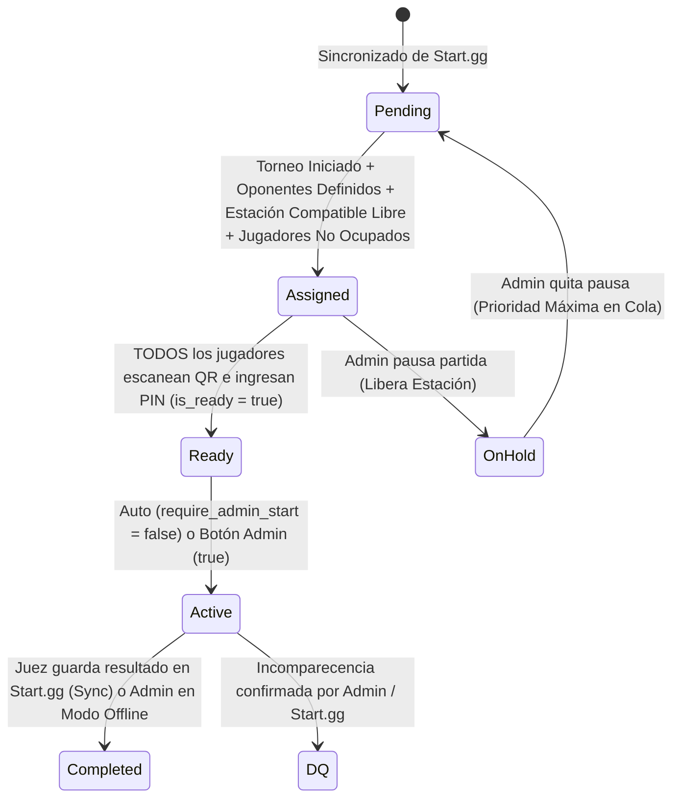

# Documento Maestro de Arquitectura y Reglas de Negocio (ARCHITECTURE.md)
## Plataforma Web Service: Gestor de Estaciones y Logística Física para Torneos (Start.gg Bridge)

---

## 1. Visión General y Propósito del Sistema

Este sistema es una plataforma Full-Stack (MVP) diseñada para gestionar la **logística física, asignación de consolas/estaciones, control de asistencia (Check-in por QR + PIN) y pantallas públicas** en torneos presenciales de eSports.

* **Fuente de la Verdad de Brackets:** **Start.gg** maneja toda la creación de brackets (Winners/Losers/Pools), progresión de rondas y captura de resultados numéricos (ej. `3-1`, `3-2`).
* **Rol de Nuestra Plataforma:** Actúa como un **orquestador físico en tiempo real**. Lee los torneos, eventos (juegos), participantes y partidas desde Start.gg; asigna automáticamente las partidas listas a las estaciones físicas según el mapa del salón (Layout) y la compatibilidad de videojuego de cada consola; valida que los jugadores estén sentados en la consola mediante código QR + PIN de 6 dígitos; y libera la estación automáticamente en cuanto el juez registra el resultado en Start.gg.
* **Modo Independiente (Offline/Local):** Permite crear torneos rápidos sin conexión a Start.gg para pruebas, simulaciones o torneos casuales locales.

---

## 2. Stack Tecnológico y Arquitectura de Software

El proyecto se estructura como un **Monorepo** preparado para contenedores (`docker-compose.yml`), garantizando un entorno local idéntico al de producción futura en la nube.

| Capa | Tecnología | Reglas Estrictas de Implementación |
| :--- | :--- | :--- |
| **Estructura** | Monorepo (`frontend/`, `backend/`, `docker-compose.yml`) | Separación clara entre cliente web y servidor de procesos continuos. |
| **Frontend** | **Next.js (React)** + **TypeScript** | App Router. Cero lógica pesada de sincronización en el cliente. |
| **Estado Global** | **Zustand** | Orquestación ligera de UI, estado del lienzo Konva y sincronización con sockets. |
| **Estilos** | **Tailwind CSS** | Prohibido el uso de librerías CSS pesadas o estilos inline innecesarios fuera de Canvas. |
| **Motor Gráfico** | **Konva.js** (`react-konva`) sobre HTML5 Canvas | **REGLA ESTRICTA:** Prohibido usar librerías de Drag & Drop del DOM (como `dnd-kit`) en el área del layout. Todo el manejo espacial vive 100% dentro del Canvas de Konva. |
| **Backend** | **NestJS** (Node.js + TypeScript) | Arquitectura modular para alojar la Cola Leaky Bucket, el Motor de Asignación, WebSockets, Timers y el Bot de Discord. |
| **Tiempo Real** | **Socket.io** (WebSockets) | Comunicación bidireccional instantánea entre Móvil (QR), Monitor Admin y Vista Pública (Proyector). |
| **Base de Datos** | **PostgreSQL** + **Prisma ORM** | Modelado relacional estricto con soporte para 1v1, 2v2 y 4v4 mediante tabla pivote. |

---

## 3. Orquestación con Start.gg y Leaky Bucket (Rate Limit)

Para proteger las credenciales del organizador y cumplir con las políticas de la API GraphQL v2 de Start.gg:

1. **Regla de Oro del Rate Limit (Leaky Bucket):**
   * **Máximo 1 petición por segundo (1 req / 1000ms)** hacia `api.start.gg/gql/alpha`.
   * **Prohibido el uso de `Promise.all()`** para disparar múltiples peticiones a Start.gg en paralelo. Todas las consultas o mutaciones entran a una cola secuencial FIFO con niveles de prioridad.
2. **Prioridad en la Cola del Leaky Bucket:**
   * **Prioridad Alta:** Acciones manuales del Admin (ej. *"Forzar sincronización de Estación #4"* o mutaciones OAuth2 de inicio de partida).
   * **Prioridad Normal:** *Background Sync* periódico de sets activos (`state: 1` Ready y `state: 2` In Progress) y lectura de resultados recién reportados (`state: 3` Completed).
   * **Prioridad Baja:** Sincronización inicial de participantes y metadatos de torneos/juegos.
3. **Consultas GraphQL Aisladas:**
   * Todas las queries y mutations de Start.gg vivirán en un módulo aislado (`startgg-queries.ts`) estrictamente tipado para evitar errores de esquema o exceso de complejidad de nodos (node limit de Start.gg).
4. **Permisos (Lectura vs OAuth2):**
   * Con Token/API Key o lectura pública: Sincronización de eventos, participantes, brackets y resultados.
   * Con OAuth2 del Organizador (opcional): Permite enviar mutaciones a Start.gg (ej. `markSetInProgress` cuando la partida pasa a `Active`).

---

## 4. Flujo Operativo de Dos Fases: Preparación del Layout vs. Ejecución en Vivo

El diseño separa la **geometría física del salón** de la **configuración específica de los torneos del día**:

### Fase A: Editor de Layouts (Plantilla Física Reutilizable)
* El administrador diseña el mapa del salón en **Konva.js** (mesas, consolas, escenario, pasillos).
* Define el orden de prioridad base (`priority_index`) en la barra lateral, nombres de estaciones e íconos.
* Asigna **Meta-Tags permanentes** de infraestructura (ej. `"Main Stage"`, `"Stream"`, `"VIP"`).
* *Nota:* En esta etapa el Layout es agnóstico a los torneos; sirve para cualquier evento futuro en ese mismo local.

### Fase B: Activación del Layout y Mapeo Multi-Juego (Pre-Torneo)
1. El administrador selecciona un Layout guardado y presiona **"Activar Layout para Evento"**.
2. **Vinculación de Torneos/Eventos de Start.gg:**
   * El administrador vincula uno o varios torneos/eventos importados desde Start.gg (los videojuegos se leen automáticamente del campo `event.videogame` de Start.gg, ej. *Super Smash Bros. Ultimate*, *Street Fighter 6*, *Tekken 8*).
3. **Asignación de Videojuegos por Estación:**
   * Con el Layout activado en modo preparación, el administrador selecciona las estaciones (individualmente o por lote) y les asigna qué videojuego(s) de los torneos vinculados pueden ejecutarse ahí (ej. *Estaciones 1-10: Smash Ultimate*, *Estaciones 11-18: SF6 y Tekken 8*, *Estación 19 Stream: Todos*).
4. **Barrera de Seguridad:** Activar el layout y mapear juegos **NO inicia la repartición de partidas**. El sistema queda en estado `ARMED / STANDBY`.

### Fase C: Inicio del Torneo y Motor de Asignación (`Iniciar Torneo`)
¿Por qué necesitamos el botón **"Iniciar Torneo"** en nuestra plataforma además del estado de Start.gg?
* En Start.gg, los brackets tienen estados (`CREATED`, `ACTIVE`, `COMPLETED`) y cada partida (`Set`) pasa a estado **"Ready / Llamable" (`state: 1`)** en cuanto tiene a sus dos jugadores definidos (sin `TBD` ni `Byes`).
* Sin embargo, los organizadores suelen publicar o abrir el bracket en Start.gg minutos u horas antes para que los jugadores revisen contra quién les toca, cuando las consolas aún siguen apagadas.
* **Regla Híbrida de Inicio (Doble Candado):**
  1. El administrador presiona **"Iniciar Torneo"** (por juego o global) en nuestra plataforma cuando las consolas están encendidas y listas.
  2. A partir de ese instante, el motor de asignación busca únicamente partidas que en Start.gg ya estén listas para jugarse (**`state: 1 (Ready)`** o **`state: 2 (In Progress)`** con ambos oponentes definidos) y las asigna a las estaciones físicas compatibles.
  3. Si el administrador presiona *"Iniciar Torneo"* en nuestra plataforma pero en Start.gg el bracket aún no ha sido iniciado por el TO, el sistema esperará pacientemente en segundo plano y, en el segundo exacto en que lo inicien en Start.gg, comenzará a repartir las estaciones automáticamente.

---

## 5. Máquina de Estados de Partidas (Matches) y Reglas del Motor

Soporte nativo para **1v1, 2v2 (Doubles) y 4v4** mediante la tabla pivote `MatchParticipant`.

### Reglas del Motor de Asignación Automática
1. **Filtro de Oponentes Definidos:** Ninguna partida con `Bye` o `TBD` (To Be Determined) puede salir de `Pending`.
2. **Filtro de Compatibilidad de Videojuego (`Videogame Match`):** Una partida del juego $X$ solo puede asignarse a una estación habilitada que tenga asignado el juego $X$ en el Layout activo.
3. **Candado Multi-Juego por Jugador (`Player Busy Lock`) e Intervención `On Hold`:**
   * Si un jugador participa en 2 o más juegos simultáneos (ej. *SF6* y *Tekken 8*), el motor verifica de forma preventiva que **ninguno de los integrantes de la partida esté actualmente en estado `Assigned`, `Ready` o `Active` en otra estación** para no bloquear consolas innecesariamente; mientras tanto, las demás partidas listas de esa cola avanzan y ocupan las estaciones libres.
   * **Liberación Manual por Retraso (`On Hold`):** En caso de que una partida ya haya sido asignada a una estación (`Assigned`) y uno de los jugadores tarde demasiado (ej. lleva 15 minutos entretenido en otro juego o ausente, manteniendo la consola vacía mientras hay otros 10 jugadores esperando turno), el Juez/Admin tiene la opción directa de pasar esa partida a estado **`On Hold` (En Espera)**. Esto **libera inmediatamente la estación** para que el motor asigne a los siguientes participantes de la cola y el flujo del torneo nunca se detenga.
4. **Prioridad de Estación (`priority_index`):** Entre las estaciones libres (`IDLE`) y compatibles con el juego, se elige siempre la de mayor prioridad (1° las marcadas como *Prioridad/Escenario*, luego en orden consecutivo de la lista lateral del Layout).
5. **Prioridad de Cola (`On Hold` Primero):** Las partidas que regresan del estado `On Hold` (cuando el jugador finalmente se desocupa y el juez le quita la pausa) tienen prioridad absoluta (`queue_priority` máxima) sobre las partidas normales en `Pending`.
6. **Manejo de Descalificaciones (DQ) en Start.gg y Modo Offline:**
   * Si el juez determina que un jugador o equipo excedió el tiempo de tolerancia y no se presentó, puede aplicar **DQ (Disqualification)**.
   * **En Torneos Conectados a Start.gg:** Cuando el juez marca el DQ en Start.gg (donde Start.gg da por terminado el set con score `-1` para el descalificado y avanza automáticamente al jugador/equipo presente a la siguiente ronda), nuestra plataforma detecta el cierre en el *Background Sync*, marca el set interno como `DQ`, libera la estación de inmediato y contabiliza el DQ en los KPIs.
   * **En Modo Independiente (Offline):** El panel del Admin cuenta con la misma función para aplicar **DQ directo** al jugador o equipo ausente, omitiendo el set, avanzando automáticamente al jugador/equipo rival que sí se presentó y liberando la consola.
7. **Cooldown Universal y Salto Manual (`Skip Cooldown`):** Al finalizar una partida (`Completed` / `DQ`), la estación entra en estado `COOLDOWN` durante $N$ segundos configurables antes de volver a `IDLE` y recibir la siguiente partida.

### Tiempos de Espera, Incomparecencia (No-Show) y Cierre de Partida
* **Alerta de No-Show (10 minutos):** Al pasar a `Assigned`, inicia un temporizador. Si tras 10 minutos faltan jugadores por validar su PIN (`is_ready = false`), se activa una alerta visual en el panel del Admin sugiriendo pasar a `On Hold` o aplicar `DQ`. **Nunca se aplica DQ de forma automática.**
* **Reporte de Resultados (Juez en Start.gg):**
  * El juez acude a la consola al finalizar el set, anota el puntaje exacto (ej. `3-0`, `3-2` o `DQ`) directamente en **Start.gg** y guarda el resultado.
  * El *Background Sync* de nuestra plataforma detecta que el set en Start.gg pasó a `COMPLETED`, registra el ganador, el marcador y el tiempo de duración para los KPIs, cambia la partida interna a `Completed` (o `DQ`) y libera la estación (iniciando su Cooldown).
  * **Botón de Sincronización Inmediata y Salto de Cooldown (`Skip Cooldown`):** El Admin puede presionar *"Refrescar / Liberar Estación Ahora"* en cualquier consola. Esta acción cumple un **doble propósito de agilidad logística**:
    1. Si la partida seguía activa esperando lectura de Start.gg, pone la consulta al frente de la cola del *Leaky Bucket* para detectar el cierre en 1 segundo.
    2. **Salta el Cooldown Universal ($N$ segundos):** Si el juez tiene prisa logística y no desea esperar el tiempo de descanso configurado para esa mesa, este botón omite o cancela el *Cooldown* inmediatamente, pasando la estación a `IDLE` y asignando la siguiente partida al instante.
  * **Excepción Modo Independiente (Offline):** En torneos creados localmente sin conexión a Start.gg se habilita en nuestro panel el botón manual para elegir ganador o aplicar **DQ** a un jugador/equipo y cerrar la partida.

---

## 6. Especificación de Módulos del Sistema

### Módulo 1: Autenticación Cerrada (Allowlist), Gestión de Staff Temporal y Lectura de Start.gg
* **Acceso Cerrado (Sin Registro Público):** En este MVP **NO existe un formulario público de "Crear Cuenta" (Sign-up)** estilo red social. Las cuentas principales de Organizadores (Correo/Usuario + Password con hash `bcrypt` + JWT) son aprovisionadas exclusivamente por el **Super Administrador (Dueño de la Plataforma)** para usuarios autorizados o testers aprobados.
* **Sistema Multi-Staff para Torneos Grandes (120+ Participantes) - `Staff Pass` Temporal:**
  * Para evitar cuellos de botella cuando un organizador necesita apoyo de varias personas para movilizar un torneo grande, el Organizador puede crear desde su panel **Accesos Temporales de Staff (`StaffAccessPass`)** sin necesidad de pedirle cuentas nuevas al Super Admin.
  * **Permisos Granulares Dinámicos (3 Modos):** Al crear un acceso de Staff (ej. para *"Juez Juan"* o *"Mesa Entrada 1"*), el organizador elige qué permisos otorgarle:
    1. **`CHECKIN_DESK` (Solo Mesa de Registro):** Permite buscar participantes y consultar/entregar sus PINs de 6 dígitos en la entrada, sin poder alterar las partidas ni el layout.
    2. **`FLOOR_JUDGE` (Solo Juez de Piso):** Permite operar el Monitor en Vivo (Llamar jugador, poner en `On Hold`, saltar Cooldown, iniciar partida, mover estación o aplicar DQ en modo offline), con opción de filtrar por videojuego asignado.
    3. **`BOTH` (Ambos Roles):** Acceso tanto a la Mesa de Registro como al Monitor de Juez de Piso (pero sin permisos destructivos como eliminar el torneo o borrar el Layout).
  * **Control en Tiempo Real por el Admin:** En cualquier momento durante el torneo, el Organizador puede **cambiar los permisos en caliente** (ej. pasar a un ayudante de `CHECKIN_DESK` a `BOTH` o `FLOOR_JUDGE` cuando termina la fila de la entrada), **pausar/deshabilitar** un acceso o **revocarlo/darlo de baja definitivamente** (`isActive = false`), desconectando su sesión de inmediato vía WebSockets.
  * **Credencial Persistente (URL y QR Recuperable):** El token/URL único y el código QR de cada ayudante quedan guardados y visibles en el panel del Organizador. Si al ayudante se le cierra el navegador, cambia de celular o pierde el enlace, el Organizador puede **volver a copiar la URL o mostrarle el QR en pantalla** en cualquier momento sin tener que crearle un acceso nuevo.
* **Consumo de Start.gg sin Vincular Cuenta Personal (Solo con URL / Slug del Torneo):**
  * Si un organizador invitado (o usuario de prueba) inicia sesión con su usuario local y **NO desea vincular su cuenta personal de Start.gg vía OAuth2**, **AÚN PUEDE consumir toda la información pública de cualquier torneo de Start.gg** simplemente pegando la **URL o el Slug/ID del torneo** (ej. `start.gg/tournament/torneo-smash-2026/event/ultimate-singles`).
  * *¿Cómo funciona técnicamente?* La API GraphQL v2 de Start.gg exige siempre una cabecera `Authorization: Bearer <TOKEN>` incluso para consultas de lectura pública. Para resolver esto de forma transparente, nuestro Backend contará con un **`STARTGG_SYSTEM_API_TOKEN` global** en sus variables de entorno (`.env`). Cuando un usuario no vincule su cuenta de Start.gg, el Backend usará automáticamente este token maestro del sistema para leer participantes, eventos, brackets y resultados a partir de la URL o ID del torneo.
  * *Diferencia entre Modo Lectura (URL) vs. Cuenta Vinculada (OAuth2):* Con solo pegar la URL, el organizador tiene el **100% de las funciones de lectura y sincronización** (incluyendo cuando el juez anota resultados en la web de Start.gg). Vincular su cuenta vía OAuth2 solo será necesario si desea que nuestra plataforma escriba mutaciones directamente hacia Start.gg en su nombre.
* **Jugadores:** Cero cuentas, cero contraseñas y cero datos personales sensibles. Únicamente identificados por su ID relacional de Start.gg (`user.id` / `entrant.id`), su Gamertag y su PIN de 6 dígitos.

### Módulo 2: Creador y Editor de Layouts (Konva.js) y Seguridad de Archivos
* CRUD completo de Layouts físicos.
* Lienzo interactivo 100% en Canvas (Zoom, Pan, Drag & Drop de estaciones, rotación y clonación).
* **Barra Lateral de Configuración Avanzada:**
  * Edición directa del nombre del Layout y del nombre del Torneo asociado.
  * **Personalización Visual del Canvas (Color Picker Hexadecimal):** Selector de paleta de colores con entrada y visualización de valor **Hexadecimal (`#RRGGBB`)** para personalizar el fondo del lienzo, bordes de zonas y colores de las estaciones.
  * **Lista Ordenable de Prioridad (`priority_index`):** Define el orden exacto de asignación de consolas.
  * **Personalización de Íconos e Imágenes por Estación:** Cada estación puede personalizar su apariencia eligiendo de un **catálogo de íconos vectoriales predeterminados** (consolas, pantallas, arcade sticks, escenario) o **subiendo una imagen propia** (`.png`, `.jpg`, `.jpeg`, `.webp`).
* **Seguridad Estricta contra Inyección de Archivos (Upload Sanitization):**
  * **Prohibición de `.svg` y ejecutables:** Se bloquean archivos `.svg` (ya que son documentos XML que pueden contener payloads XSS con `<script>`) y cualquier extensión ejecutable o de script.
  * **Validación de Magic Bytes (Firma Binaria):** No se confía solo en la extensión o el header `Content-Type`; el backend verifica los primeros bytes reales del archivo (`89 50 4E 47` para PNG, `FF D8 FF` para JPEG).
  * **Re-codificación y Limpieza con `sharp`:** Toda imagen subida pasa por la librería `sharp` en el backend, la cual elimina metadatos EXIF/comentarios maliciosos, re-codifica los píxeles limpios (ej. a WebP/PNG optimizado de máximo `512x512px`), le asigna un nombre `UUID` aleatorio (evitando *Path Traversal*) y la sirve desde almacenamiento estático sin permisos de ejecución.
* Selección bidireccional con animación de pulso/parpadeo en el lienzo para ubicar estaciones rápidamente.
* Gestión de etiquetas operativas (`"Stream"`, `"Sin DLCs"`, `"Escenario"`).

### Módulo 3: Check-in Desk (Gestión de Participantes y Regla Global de PINs)
* Búsqueda en tiempo real por Gamertag y filtro por Torneo/Evento.
* **Almacenamiento en Texto Plano (`VARCHAR(6)`):** Por requerimiento operativo, los PINs no se hashean para que el staff de registro o los jueces puedan consultarlos y dictarlos al instante si un jugador olvida su código.
* **Switch Global de Modo de PIN (Automatizado a Nivel Evento/Layout):**
  * En lugar de elegir jugador por jugador, el organizador cuenta con un **Switch Global en la configuración del evento** con dos modos automáticos:
    1. **Modo PIN Único (Unificado por Jugador):** Si el sistema detecta que un mismo jugador está inscrito en 2 o más torneos/juegos simultáneos, el generador en lote le asigna automáticamente **el mismo PIN de 6 dígitos** para todos sus juegos.
    2. **Modo PIN Individual por Juego (Aislado):** Si el switch está en modo aislado, el sistema genera automáticamente un **PIN distinto por cada torneo/juego** en el que participe el jugador. En la búsqueda del Check-in Desk se muestra al jugador agrupado con el desglose claro de cada juego y su respectivo PIN.

### Módulo 4: Flujo Móvil del Jugador (Web View Exclusivo por QR de Estación)
* Cada estación física tiene pegado un **QR estático** que codifica una URL única ligada exclusivamente a esa estación (ej. `https://dominio.com/station/[station_uuid]`).
* Al escanearlo con la cámara de su celular, se abre un **Web View limpio en el navegador móvil** dedicado exclusivamente a mostrar la información en vivo de esa estación: *"Estación #X - [Juego] - Jugador 1 vs Jugador 2"*.
* El jugador selecciona su Gamertag, ingresa su PIN de 6 dígitos (`POST /api/checkin`) y su estado individual cambia a `is_ready = true` en tiempo real vía WebSockets.

### Módulo 5: Administración del Torneo en Vivo (Live Monitor)
* Activación del Layout, mapeo de videojuegos a estaciones y botón maestro **"Iniciar Torneo"**.
* Vista en vivo del mapa de Konva coloreado según el estado de cada consola (`Idle`, `Assigned`, `Ready`, `Active`, `On Hold`, `Cooldown`, `Disabled`).
* Switch `require_admin_start` (Inicio automático al completar QR vs. Confirmación manual del juez).
* Herramientas de intervención manual:
  * **Llamar a Jugador:** Dispara alerta visual y sonora en la Vista Pública.
  * **Mover de Estación:** Reasigna una partida en curso o asignada a otra consola libre.
  * **Pausar (`On Hold`):** Libera la consola de inmediato (ideal cuando un jugador tarda demasiado por estar en otro juego o ausente) y guarda la partida para devolverla al tope de la cola cuando esté disponible.
  * **Saltar Cooldown (`Skip Cooldown`):** Omite el tiempo de enfriamiento de una consola para asignar la siguiente partida de inmediato.
  * **Apagado Progresivo de Estación:** Marca una consola para que no reciba más partidas al terminar la actual (o la apaga de inmediato si está libre).

### Módulo 6: Vista Pública (Pantalla de Audiencia / Proyector)
* Interfaz de alto contraste y pantalla dividida conectada por WebSockets:
  * **Izquierda (Mapa y Estaciones Activas):** Mapa limpio del Layout y tarjetas de estaciones con las partidas asignadas/en curso.
  * **Derecha (Cola de Espera):** Próximas partidas en estado `Pending` próximas a ser llamadas.
  * **Overlay de Alertas:** Animaciones destacadas cuando un juez presiona *"Llamar a Jugador"*, indicando nombre, juego y número de estación.

### Módulo 7: Impresión en Lote (Print & Export PDF con Ahorro de Papel)
* Generador de PDF listo para impresión con los códigos QR estáticos de todas las estaciones del Layout activo.
* **Formatos y Densidad Configurable (Ahorro de Hojas):**
  * **Modo Multi-QR por Página (Hoja Carta / Letter y A4):** Permite imprimir **varios códigos QR en una misma hoja** en formato de cuadrícula/grilla recortable (ej. **2, 4, 6, 9 o 12 QRs por página** seleccionable por el organizador) para ahorrar papel y costos de impresión.
  * **Modo Individual / Etiqueta Térmica:** 1 QR por página o tamaño etiqueta adhesiva con el número, ícono y nombre de la estación.

### Módulo 8: Notificaciones en Discord (Bot Node.js)
* Anuncio automático en el canal del torneo cuando una partida pasa a `Assigned` (ej. *"🎮 **[SF6]** ¡Partida asignada! **Jugador A** vs **Jugador B** -> Pasar a **Estación #4**"*).
* Control de idempotencia mediante bandera `discord_notified = true` en la base de datos para evitar spam o mensajes duplicados si se reinicia el servicio.

### Módulo 9: Dashboard de Información y KPIs Personalizable
* **Widgets Modulares (Mostrar / Ocultar KPIs):** El organizador puede personalizar su vista del Dashboard activando, ocultando o reordenando qué tarjetas de KPI desea ver en pantalla (guardando su preferencia en su perfil/estado), manteniendo una interfaz limpia solo con las métricas que le interesan.
* Catálogo de métricas disponibles en vivo e históricas por torneo/juego:
  * Total de inscritos, partidas completadas, partidas activas, partidas en `On Hold` y DQs aplicados.
  * Seguimiento automático de **Top 8 / Top 3**.
  * **Tiempo promedio de partida** por videojuego (calculado entre `started_at` al pasar a `Active` y `completed_at` al detectarse el cierre en Start.gg).

---

## 7. Contratos Core de API y Eventos WebSocket

### REST Endpoints Principales
* `POST /api/checkin`
  * **Request:** `{ "station_id": "uuid", "participant_id": "uuid", "pin_code": "123456" }`
  * **Response:** `{ "success": true, "player_ready": true, "match_state": "ready" | "active" | "assigned" }`
* `POST /api/layouts/:id/activate`
  * **Request:** `{ "tournament_ids": ["uuid"], "station_game_map": { "station_uuid": ["game_id_1", "game_id_2"] } }`
* `POST /api/tournaments/:id/start`
  * Activa el motor de asignación para repartir las partidas listas (`state: 1` en Start.gg) en las estaciones compatibles.
* `POST /api/tournaments/:id/staff-passes` & `PATCH /api/staff-passes/:passId`
  * Crea, modifica en caliente (`permission_mode`: `CHECKIN_DESK` | `FLOOR_JUDGE` | `BOTH`, `is_active`: `true` | `false`) o consulta la URL/QR persistente de un acceso temporal de Staff para ayudantes del torneo.

### Eventos WebSocket (Socket.io)
* `station:updated` -> Actualiza el estado visual de una consola en Monitor Admin, Móvil y Vista Pública.
* `match:state_changed` -> Notifica transiciones (`Pending` -> `Assigned` -> `Ready` -> `Active` -> `Completed`).
* `player:called` -> Dispara la animación de llamado de jugador en la Vista Pública (`{ gamerTag, stationNumber, stationName, gameName }`).
* `queue:updated` -> Actualiza la lista de próximas partidas en la pantalla pública.
* `staff:permissions_updated` -> Actualiza en tiempo real la interfaz del ayudante cuando el Organizador le habilita/deshabilita un modo (`CHECKIN_DESK` / `FLOOR_JUDGE` / `BOTH`) o le cierra la sesión inmediatamente si fue dado de baja (`is_active = false`).

---

## 8. Roadmap de Desarrollo por Fases

1. **Fase 1: Cimientos, Docker y Base de Datos (Core & Data Model)**
   * Configuración del Monorepo (`frontend`, `backend`, `docker-compose.yml` con PostgreSQL).
   * Definición del esquema completo en Prisma (`schema.prisma`) contemplando multi-juego, layouts, estaciones, participantes, PINs en texto plano y máquina de estados.
2. **Fase 2: Motor de Estados, Asignación Multi-Juego y Modo Independiente**
   * Implementación en NestJS de la máquina de estados, el asignador con filtros de compatibilidad de juego, bloqueo de jugador ocupado (`Player Busy Lock`), `priority_index`, *Cooldown*, *On Hold*, endpoint `/api/checkin` y WebSockets.
3. **Fase 3: Editor Visual de Layouts (Konva.js) y Generador de QRs (PDF)**
   * Desarrollo del lienzo en Konva.js, barra lateral de prioridad, mapeo de videojuegos por estación al activar el layout y exportación de QRs en PDF (Carta, A4, Térmica).
4. **Fase 4: Paneles Operativos en Tiempo Real**
   * Construcción del Check-in Desk (con generador de PINs en modo Único o Por Torneo), Vista Móvil de Check-in QR, Monitor Admin en Vivo y Vista Pública con alertas.
5. **Fase 5: Orquestador Start.gg (Leaky Bucket + GraphQL + OAuth2), KPIs y Bot de Discord**
   * Cola secuencial estricta de 1 req/seg conectada a Start.gg GraphQL v2, lectura automática de cierres de partida reportados por los jueces, panel de KPIs y Bot de Discord.

---

## 9. Protocolo de Trabajo y Asistencia Paso a Paso (Regla de Desarrollo)

Durante todo el desarrollo del proyecto se seguirá estrictamente esta regla de acompañamiento:

1. **No asumir programas preinstalados:** Antes de ejecutar cualquier comando o iniciar una fase que requiera un software en la computadora (ej. **Node.js**, **Git**, **PostgreSQL**, **Docker Desktop**, etc.), primero verificaremos/preguntaremos si ya está instalado y configurado. Si no lo está, se proporcionará una **guía paso a paso clara** para instalarlo o configurarlo juntos.
2. **No asumir cuentas o tokens de desarrollador listos:** Antes de integrar servicios externos que requieran cuentas de desarrollador, API Keys o configuración de portales externos (ej. **Portal de Desarrolladores de Discord** para crear el Bot, o **Developer Settings de Start.gg** para obtener el Personal Access Token / OAuth2), se explicará paso a paso dónde entrar, qué botones presionar y cómo obtener las credenciales sin asumir conocimiento previo.
3. **Verificación conjunta antes de avanzar:** Cada vez que se configure una herramienta o entorno nuevo, haremos una prueba rápida para confirmar que funciona correctamente en tu máquina antes de continuar programando.

